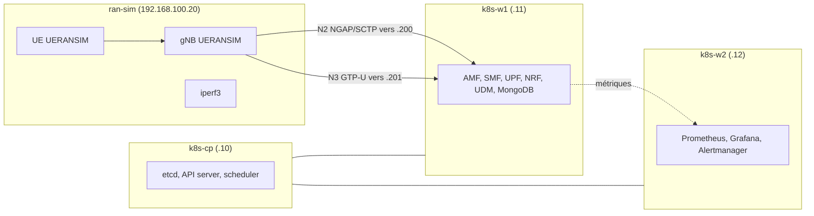

# Architecture

## Plan d'adressage

| Élément | Valeur |
|---------|--------|
| Réseau VM (VMnet8, NAT) | 192.168.100.0/24, passerelle .2 |
| k8s-cp / k8s-w1 / k8s-w2 / ran-sim / wazuh | .10 / .11 / .12 / .20 / .30 |
| Pod CIDR (Calico) | 10.244.0.0/16 |
| Service CIDR | 10.96.0.0/12 |
| Pool MetalLB (L2) | 192.168.100.200-210 (AMF .200, UPF .201) |

## Dimensionnement

| VM | vCPU | RAM | Disque |
|----|------|-----|--------|
| k8s-cp | 2 | 3 Go | 25 Go |
| k8s-w1 | 3 | 6 Go | 35 Go |
| k8s-w2 | 3 | 6 Go | 40 Go |
| ran-sim | 2 | 2 Go | 15 Go |
| wazuh (phase 2) | 4 | 8 Go | 40 Go |
