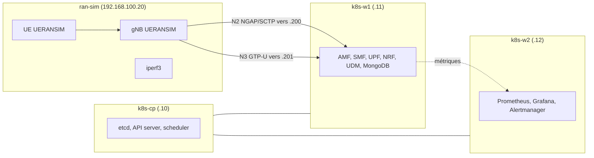

# Cahier des charges : cœur 5G cloud-native sur Kubernetes, supervisé

> [!abstract] Résumé
> Déployer un cœur 5G SA (Open5GS) et un RAN simulé (UERANSIM) sur un cluster Kubernetes (kubeadm), le superviser avec Prometheus/Grafana/Alertmanager, puis **quantifier sa résilience** par injection de pannes.

> [!warning] Hypothèses à valider
> Durée de 8 à 10 semaines et valeurs cibles (délais, débits) sont des **hypothèses de travail**. Remplace-les par tes mesures après les premiers essais. Les versions logicielles (Open5GS, Calico, charts Helm) évoluent vite : épingle-les et vérifie la compatibilité.

---

## 1. Présentation du projet

| Champ             | Contenu                                                                                   |
| ----------------- | ----------------------------------------------------------------------------------------- |
| **Titre**         | Conception, déploiement et supervision d'un cœur 5G cloud-native sur Kubernetes (kubeadm) |
| **Porteur**       | Mohamed TRAORE, élève-ingénieur 3e année SCSN, ENSA Fès                                   |
| **Encadrant**     | *(Projet perso)*                                                                          |
| **Durée**         | *(8-10 semaines, à confirmer)*                                                            |
| **Environnement** | VMware Workstation, hôte 32 Go RAM / 180 Go SSD                                           |

## 2. Contexte et problématique

La 5G SA repose sur une **architecture orientée services (SBA)** : chaque fonction réseau (AMF, SMF, UPF…) est un microservice conteneurisé (3GPP TS 23.501). Les opérateurs les exécutent sur Kubernetes, avec les enjeux de résilience et d'observabilité que cela implique.

**Problématique (à reformuler dans le rapport) :**

> Comment déployer un cœur 5G SA sur Kubernetes, le superviser de bout en bout, et **quantifier sa résilience** face aux pannes de fonctions réseau ?

> [!tip] Piste
> Une bonne problématique contient une **mesure**. Ici : l'écart entre le *temps de reprise du pod* et le *temps de rétablissement du service pour l'UE*.

## 3. Objectifs

| Type | Objectif |
|------|----------|
| **Général** | Plateforme 5G SA fonctionnelle, observable et résiliente sur K8s |
| **O1** | Déployer un cluster K8s multi-nœuds (kubeadm) adapté aux contraintes 5G (SCTP, GTP-U) |
| **O2** | Déployer Open5GS et UERANSIM avec connectivité de bout en bout |
| **O3** | Mettre en place la supervision (métriques, dashboards, alertes) |
| **O4** | Mesurer performances et résilience par injection de pannes |
| **O5** *(optionnel)* | Intégrer Wazuh pour la sécurité opérationnelle |

### Points spécifiques à la 5G (à anticiper)

|Sujet|Problème|Solution|
|---|---|---|
|**SCTP (N2)**|Le CNI et kube-proxy doivent gérer SCTP|**Calico** ou **Cilium** (vérifie la prise en charge SCTP de ta version)|
|**Exposition de l’AMF**|Le gNB externe doit joindre l’AMF|**MetalLB** (mode L2) ou `hostNetwork` / NodePort ⚠️ test SCTP à valider|
|**UPF**|Besoin de `NET_ADMIN`, device TUN, parfois `privileged`|`securityContext` adapté, nœud dédié via `nodeSelector`|
|**free5GC**|Le module noyau **gtp5g** est requis (dépend de la version du noyau)|Ubuntu 22.04 et noyau compatible ; ⚠️ vérifier la doc free5GC|
|**Open5GS**|Pas de module noyau, plus simple|**Recommandé pour démarrer**|
|**Multi-interfaces N2/N3/N4**|Un seul `eth0` par pod par défaut|**Multus CNI** (optionnel, plus réaliste)|
|**Stockage MongoDB**|Pas de StorageClass par défaut|`local-path-provisioner` ou Longhorn|

### Pile logicielle conseillée

```
OS            : Ubuntu Server 22.04 LTS (noyau 5.15)
Runtime       : containerd
K8s           : kubeadm (version stable récente ⚠️ à vérifier)
CNI           : Calico (SCTP) [+ Multus en option]
LoadBalancer  : MetalLB
Stockage      : local-path-provisioner
Ingress       : Traefik (tu le connais déjà)
5G Core       : Open5GS (chart Helm communautaire, ex. Gradiant 5g-charts ⚠️ vérifier l'état du dépôt)
RAN           : UERANSIM
Monitoring    : kube-prometheus-stack (Helm)
```

### Étapes de mise en œuvre

```
1. VM + réseau  ──► 2. kubeadm init/join ──► 3. CNI + MetalLB + stockage
                                                     │
2. UERANSIM + tests ◄── 5. Open5GS (Helm) ◄── 4. kube-prometheus-stack
        │
        └──► 7. Injection de pannes + mesures
```

## 4. Périmètre

| ✅ Inclus | ❌ Exclu |
|-----------|---------|
| 5G SA (Release 15/16 selon Open5GS) | Radio réelle (SDR, USRP) |
| Cœur 5G conteneurisé + gNB/UE simulés | Cœur 5G en haute disponibilité multi-sites |
| Supervision Prometheus/Grafana/Alertmanager | Tests d'attaque sur réseau réel |
| Tests de pannes et de charge légère | Mise en production |

> [!tip] Piste
> La colonne « Exclu » protège le projet contre l'élargissement du périmètre. Un jury apprécie qu'elle soit explicite.

## 5. Architecture cible



Version ASCII (pour l'export PDF ou les éditeurs sans Mermaid) :

```
                    ┌──────────────── Hôte VMware Workstation ────────────────┐
   ran-sim (.20)    │   k8s-cp (.10)     k8s-w1 (.11)       k8s-w2 (.12)      │
  ┌────────────┐    │  ┌───────────┐    ┌─────────────┐    ┌───────────────┐  │
  │ gNB (UERAN)│N2  │  │ etcd      │    │ AMF SMF UPF │    │ Prometheus    │  │
  │ UE  (UERAN)│───►│  │ API server│    │ NRF UDM ... │    │ Grafana       │  │
  │ iperf3     │N3  │  │ scheduler │    │ MongoDB     │    │ Alertmanager  │  │
  └────────────┘    │  └───────────┘    └─────────────┘    └───────────────┘  │
        ▲           │       └──── Calico (CNI) + MetalLB (.200-.210) ────┘    │
        └── N2: 192.168.100.200 (AMF, SCTP)   N3: 192.168.100.201 (UPF) ──────┘
```

### Plan d'adressage

| Élément | Valeur |
|---------|--------|
| Réseau VM (VMnet8, NAT) | `192.168.100.0/24`, passerelle `.2` |
| `k8s-cp` / `k8s-w1` / `k8s-w2` / `ran-sim` / `wazuh` | `.10` / `.11` / `.12` / `.20` / `.30` |
| Pod CIDR (Calico) | `10.244.0.0/16` |
| Service CIDR | `10.96.0.0/12` |
| Pool MetalLB (L2) | `192.168.100.200-210` (AMF `.200`, UPF `.201`) |

### Dimensionnement

| VM | Rôle | vCPU | RAM | Disque (thin) |
|----|------|------|-----|---------------|
| `k8s-cp` | Control plane | 2 | 3 Go | 25 Go |
| `k8s-w1` | Cœur 5G | 3 | 6 Go | 35 Go |
| `k8s-w2` | Monitoring | 3 | 6 Go | 40 Go |
| `ran-sim` | UERANSIM + iperf3 | 2 | 2 Go | 15 Go |
| **Phase 1** | | **10** | **17 Go** | **~115 Go** |
| `wazuh` *(phase 2)* | Wazuh all-in-one | 4 | 8 Go | 40 Go |
| **Total** | | **14** | **25 Go** | **~155 Go** |

> [!note]
> Estimations à confirmer avec `kubectl top nodes` et `free -h`. Garder 15-20 % de SSD libre. La nested virtualization n'est **pas nécessaire** (les conteneurs n'utilisent pas VT-x).

## 6. Exigences fonctionnelles

| ID | Exigence | Priorité | Critère d'acceptation |
|----|----------|----------|------------------------|
| **EF1** | Cluster K8s opérationnel (1 CP + 2 workers) | Must | `kubectl get nodes` : 3 nœuds `Ready` |
| **EF2** | Stockage persistant pour MongoDB | Must | PVC `Bound`, données conservées après redémarrage du pod |
| **EF3** | Exposition de l'AMF en SCTP au gNB externe | Must | Association NGAP établie (log gNB : *NG Setup successful*) |
| **EF4** | Enregistrement d'un UE et session PDU | Must | Interface `uesimtun0` créée, IP attribuée par le SMF |
| **EF5** | Connectivité de données via l'UPF | Must | `ping` et `iperf3` via `uesimtun0` réussis |
| **EF6** | Dashboards 5G (UE, sessions, état des NF) | Must | Dashboard Grafana avec ≥ 4 panneaux 5G |
| **EF7** | Alertes (NF down, CPU/mémoire, nœud injoignable) | Must | Alerte reçue pour chaque scénario de test |
| **EF8** | Plusieurs UE simultanés | Should | N UE enregistrés (ex. 5 à 20) |
| **EF9** | Déploiement scripté (Helm values versionnés, Git) | Should | Redéploiement depuis zéro par scripts |
| **EF10** | Pipeline CI/CD de validation | Could | Job GitHub Actions testant attachement + ping |
| **EF11** | Intégration Wazuh | Could | Logs du cœur remontés + 1 règle personnalisée |

> [!tip] Piste (EF3)
> SCTP est le point dur du projet. Vérifie le support dans ta version de Calico, puis teste `Service` LoadBalancer (MetalLB) ou `hostNetwork`. Garde la **solution retenue et les échecs** dans le rapport : c'est du bon contenu technique.

## 7. Exigences non fonctionnelles

| ID | Exigence | Cible (hypothèse) | Mesure |
|----|----------|-------------------|--------|
| **ENF1** | Ressources | ≤ 25 Go RAM VM, ≤ 155 Go disque | `free -h`, `kubectl top` |
| **ENF2** | Reproductibilité | Redéploiement complet en < 1 h | Chronométrer 2 déploiements |
| **ENF3** | Observabilité | 100 % des NF principales supervisées | Cibles `UP` dans Prometheus |
| **ENF4** | Isolation | Cœur et monitoring sur nœuds distincts | `nodeSelector` / `taints` |
| **ENF5** | Documentation | Procédure reproductible par un tiers | Relecture par un pair |
| **ENF6** | Sécurité de base | Lab isolé, pas d'exposition externe | Réseau VMnet dédié |

## 8. Plan de tests et indicateurs

> [!important]
> Répète chaque test **5 à 10 fois** et donne moyenne, minimum, maximum et écart-type.

| ID | Test | Indicateur | Outil | Valeur attendue |
|----|------|-----------|-------|-----------------|
| **T1** | Enregistrement d'un UE | Temps d'attachement (s) | Logs UERANSIM, Wireshark | À mesurer |
| **T2** | Débit via l'UPF | Mbit/s (TCP/UDP), perte, gigue | `iperf3` | À mesurer (borné par la VM) |
| **T3** | Latence via l'UPF | RTT moyen (ms) | `ping` | À mesurer |
| **T4** | Suppression du pod **UPF** | Reprise du pod, reprise du flux | `kubectl`, `ping -i 0.2` | À mesurer |
| **T5** | Suppression du pod **AMF** | Reprise du pod **et** du service pour l'UE | Logs gNB/UE | À mesurer |
| **T6** | Suppression du pod **SMF** | Impact sur les sessions PDU existantes | Logs, `ping` | À mesurer |
| **T7** | Arrêt d'un nœud worker | Replanification des pods | `kubectl get pods -w` | À mesurer |
| **T8** | Surcharge CPU d'un nœud | Délai de déclenchement de l'alerte | `stress-ng`, Alertmanager | À mesurer |
| **T9** | Montée en charge UE | Taux de réussite vs N UE | Script UERANSIM | À mesurer |

```
Chronologie d'une panne AMF (à reconstituer avec les horodatages) :

 t0          t1                t2                 t3
 │  kill pod │ pod recréé      │ AMF prêt (Ready) │ UE re-enregistré
 ├───────────┼─────────────────┼──────────────────┤
 │◄── reprise du pod ─────────►│                  │
 │◄─────────────── rétablissement du service pour l'UE ────────────►│
```

> [!tip] Pistes
> - Synchronise l'heure des VM (`chrony`) avant de comparer des horodatages entre machines.
> - Un `readinessProbe` et des `requests/limits` bien réglés changent fortement le temps de reprise : compare **avec et sans** réglage, c'est une vraie contribution.

## 9. Livrables

| # | Livrable | Contenu |
|---|----------|---------|
| L1 | Dépôt Git | Scripts, manifestes, `values.yaml` Helm, README |
| L2 | Plateforme fonctionnelle | Démonstration de bout en bout |
| L3 | Dashboards Grafana | Export JSON versionné |
| L4 | Règles d'alerte | Fichiers `PrometheusRule` |
| L5 | Rapport de tests | Résultats T1-T9 (tableaux, graphiques) |
| L6 | Rapport final | Voir plan ci-dessous |
| L7 | Soutenance | Présentation + démo ou vidéo de secours |

**Plan type du rapport :**

1. Introduction et problématique
2. État de l'art (5G SA, SBA, cloud-native, observabilité)
3. Conception (architecture, dimensionnement, choix justifiés)
4. Réalisation (déploiement, difficultés et solutions)
5. Supervision (métriques, dashboards, alertes)
6. Évaluation (protocole, résultats, analyse)
7. Limites et perspectives (sécurité Wazuh, slicing, MEC)
8. Annexes (configurations, captures Wireshark annotées)

## 10. Planning prévisionnel

| Sem. | Tâches | Jalon |
|------|--------|-------|
| 1 | Étude 5G SA, template Ubuntu, réseau VMware | VM prêtes |
| 2 | kubeadm + Calico + MetalLB + stockage | **J1** : cluster `Ready` |
| 3 | kube-prometheus-stack | **J2** : Grafana accessible |
| 4 | Open5GS (Helm) + exposition SCTP | NG Setup réussi |
| 5 | UERANSIM, session PDU, iperf3 | **J3** : ping via UPF |
| 6 | Métriques 5G, dashboards, alertes | **J4** : supervision complète |
| 7 | Injection de pannes (T4-T8), mesures répétées | Données brutes |
| 8 | Wazuh *(option)*, automatisation Git/CI | **J5** : redéploiement scripté |
| 9 | Analyse des résultats, rapport | Brouillon |
| 10 | Finalisation, soutenance | **Livraison** |

> [!tip] Piste
> Prends un snapshot VMware à chaque jalon : si une expérience casse le lab, tu perds une heure et non une semaine.

## 11. Risques et parades

| Risque | Probabilité | Impact | Parade |
|--------|-------------|--------|--------|
| SCTP non supporté ou mal exposé | Élevée | Fort | Tester tôt (sem. 4) ; `hostNetwork`, NodePort ou MetalLB ; garder une alternative |
| Chart Helm Open5GS obsolète | Moyenne | Moyen | Épingler les versions ; manifestes maison en secours |
| RAM insuffisante | Moyenne | Moyen | Wazuh en option ; réduire la rétention Prometheus |
| Métriques Open5GS indisponibles dans ta version | Moyenne | Moyen | kube-state-metrics, cAdvisor, logs, exporters |
| Mesures bruitées (VM sur un même hôte) | Élevée | Moyen | Répétitions, moyenne et écart-type, hôte au repos |
| Perte du lab (corruption) | Faible | Fort | Snapshots + tout dans Git |
| Retard cumulé | Moyenne | Moyen | MoSCoW : couper EF10 et EF11 en premier |

## 12. Normes et références

| Domaine | Référence |
|---------|-----------|
| Architecture 5G | 3GPP TS 23.501 |
| Procédures (enregistrement, session PDU) | 3GPP TS 23.502 |
| Sécurité 5G | 3GPP TS 33.501 |
| Interfaces N2 / N4 / N3 | TS 38.413 (NGAP), TS 29.244 (PFCP), TS 29.281 (GTP-U) |
| Transport SCTP | RFC 9260 (remplace RFC 4960) |
| Sécurité Kubernetes | CIS Kubernetes Benchmark, OWASP Kubernetes Top 10 |
| Menaces 5G (volet sécurité) | MITRE FiGHT |
| Gestion de la sécurité *(optionnel)* | ISO/IEC 27001 |

> [!warning]
> Vérifie le **numéro de release** de chaque TS utilisé et la version d'Open5GS : le comportement diffère d'une release à l'autre.

## 13. Critères de réussite

- [ ] Cluster 3 nœuds `Ready`, composants épinglés en version
- [ ] UE enregistré, session PDU établie, `ping` + `iperf3` via l'UPF
- [ ] Dashboard Grafana avec métriques 5G et état des NF
- [ ] ≥ 3 alertes testées et déclenchées avec délai mesuré
- [ ] T4 et T5 mesurés ≥ 5 fois, avec distinction pod / service
- [ ] Dépôt Git permettant de reconstruire le lab
- [ ] Rapport avec analyse critique des limites

---

## 14. Suivi d'avancement

### Jalons

- [ ] J1 : cluster `Ready` (sem. 2)
- [ ] J2 : Grafana accessible (sem. 3)
- [ ] J3 : ping via UPF (sem. 5)
- [ ] J4 : supervision complète (sem. 6)
- [ ] J5 : redéploiement scripté (sem. 8)
- [ ] Livraison (sem. 10)

### Journal de bord

| Date | Fait | Problème rencontré | Solution / à faire |
|------|------|--------------------|--------------------|
|      |      |                    |                    |

### Résultats des mesures (à remplir)

| Test | Essais | Moyenne | Min | Max | Écart-type | Remarque |
|------|--------|---------|-----|-----|------------|----------|
| T1 |  |  |  |  |  |  |
| T4 |  |  |  |  |  |  |
| T5 |  |  |  |  |  |  |
| T8 |  |  |  |  |  |  |

## 15. Pistes de révision

1. Reformule la problématique en une phrase contenant **un indicateur mesurable**.
2. Pourquoi sépare-t-on « temps de reprise du pod » et « temps de rétablissement du service » ? Que se passe-t-il côté NGAP et NAS lors d'un redémarrage de l'AMF ?
3. Rédige 3 exigences non fonctionnelles au format *« Le système doit…, mesuré par… »*.
4. Si l'écart-type de tes 5 mesures T4 est élevé, que peux-tu en conclure ?
5. Différence entre `readinessProbe` et `livenessProbe` : lequel influence le trafic vers l'AMF ?
6. Classe tes exigences en MoSCoW et justifie pourquoi EF11 est en *Could*.

## Notes liées

- [[Architecture 5G SA]]
- [[Dimensionnement VMware]]
- [[Journal de bord 5G]]
- [[Résultats tests T1-T9]]
